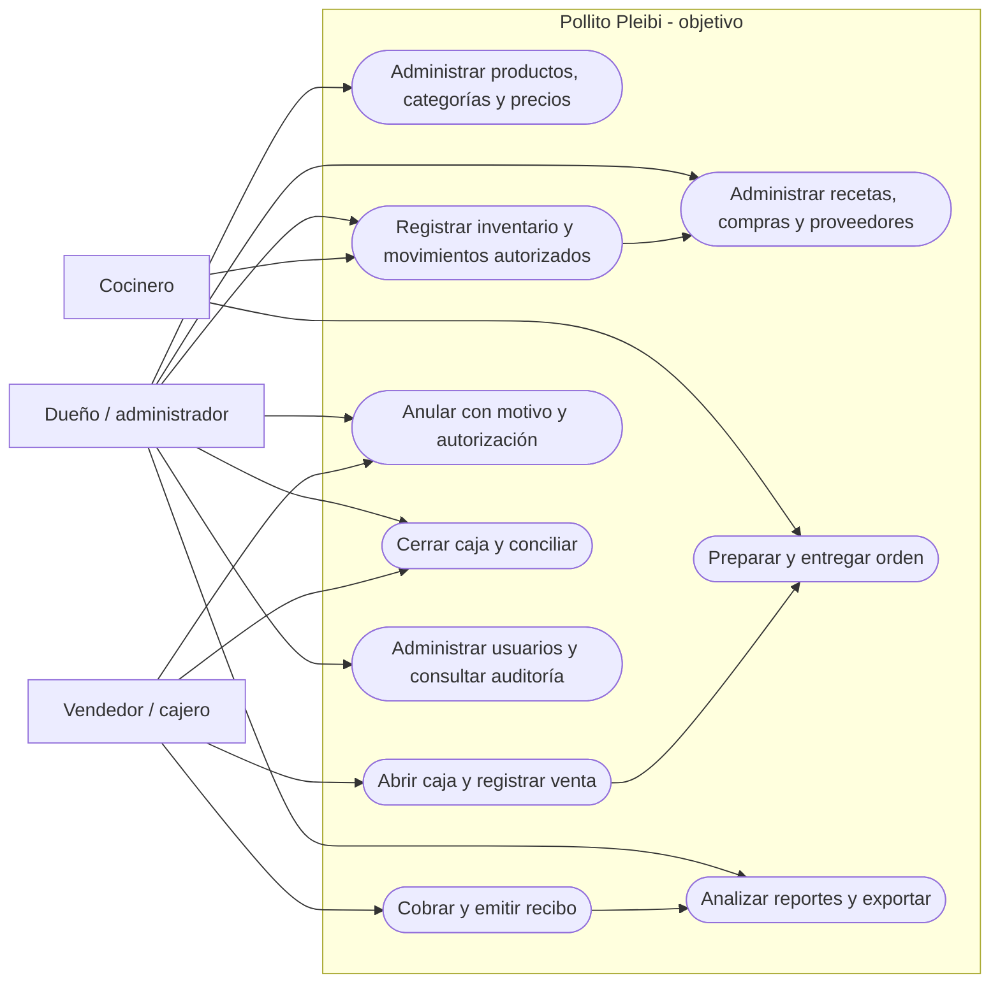
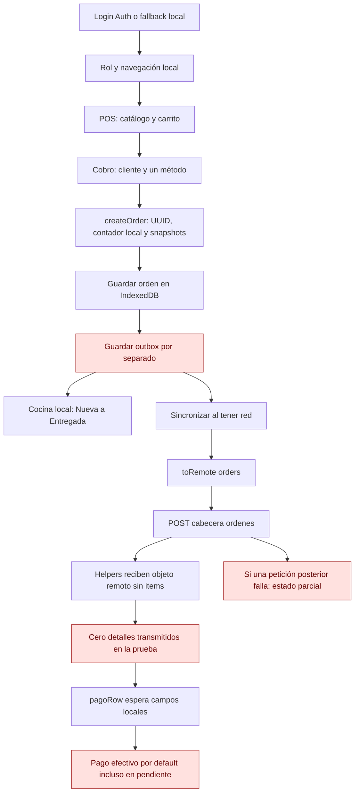
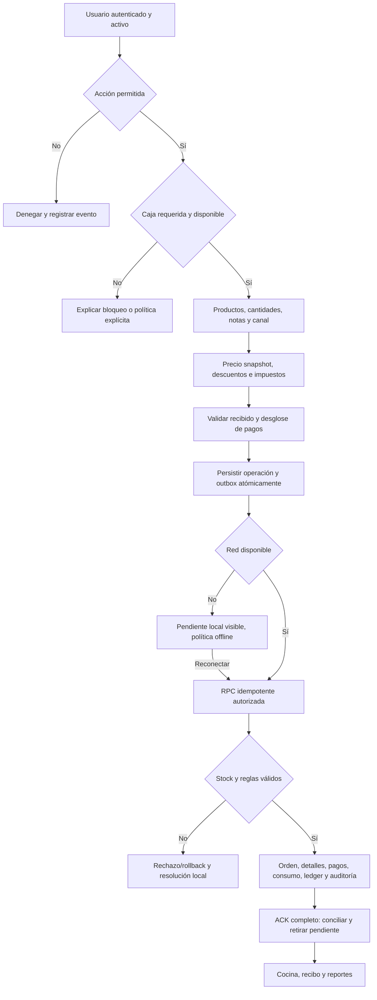
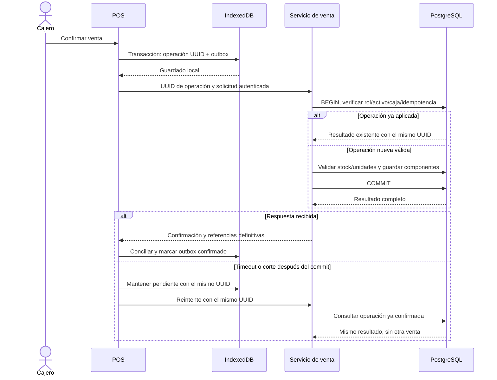
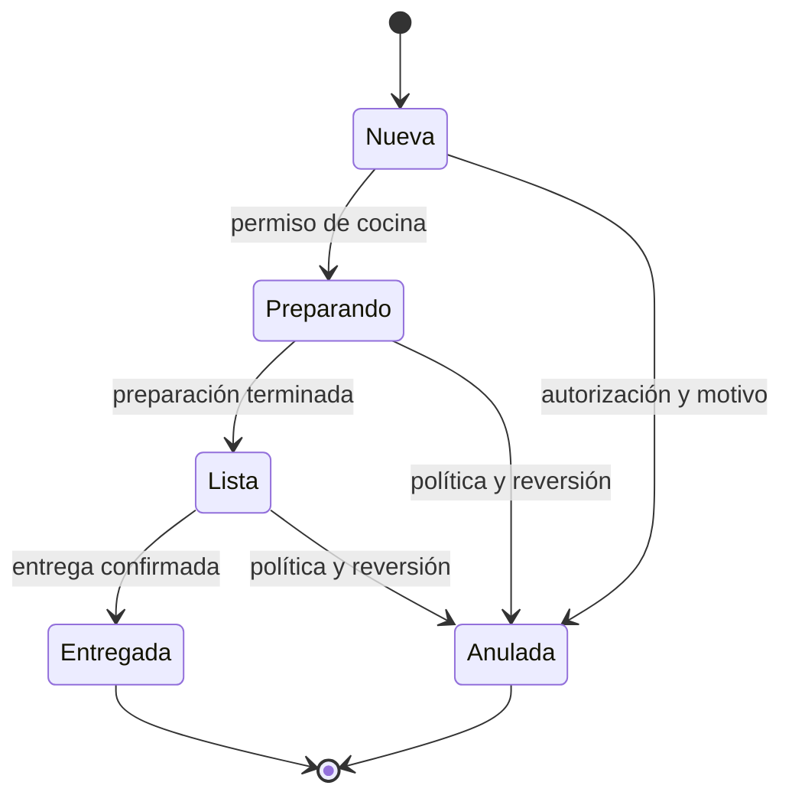
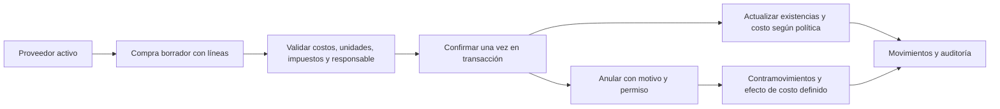
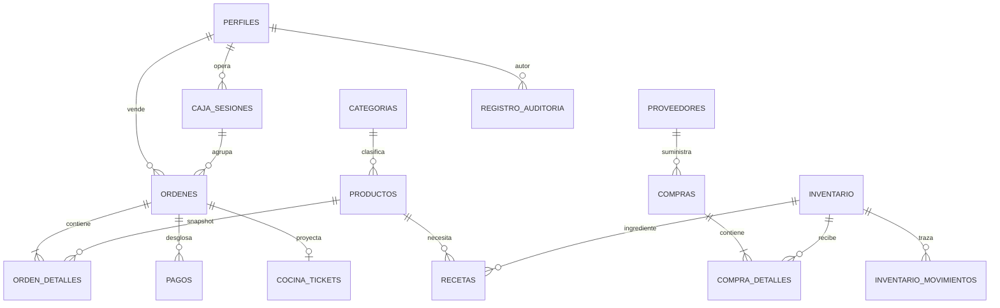

# Workflow revisado y diagramas

## Actualización de implementación — 2026-11-11

El flujo de apertura de caja, comprobante comercial y confirmación compuesta de sync
se describe en [Caja y comprobantes](../CAJA_COMPROBANTES_20261111.md), con sus pruebas
locales y límites remotos. Los diagramas de auditoría siguientes conservan su contexto
histórico; no acreditan el despliegue de esta migración en Supabase.

Referencia: ficha técnica del proyecto y casos E1–E8 del usuario. Se contrastaron
con router, repositorio, mapeadores, cola y SQL. Los diagramas distinguen **actual**
y **objetivo**; el objetivo no indica que esas funciones estén implementadas.
Se pueden renderizar en visores Markdown compatibles con Mermaid.
También están [exportados y verificados como SVG](diagramas/README.md).

## 1. Mapa de casos de uso objetivo

Mermaid no proporciona aquí UML use-case nativo; se usa un grafo equivalente de
actores y casos de uso. El detalle de permisos está en SUPABASE_LOCAL_ONLINE.md.

Cajero y cocinero no reciben automáticamente todos los permisos de los casos
compartidos: anulación/ajuste/cierre deben comprobar autorización y propiedad.

## 2. Flujo actual comprobado

No hay receta/caja integradas en este recorrido. No confundir creación del ticket
por trigger con venta, pagos y consumo de stock en una sola transacción.

## 3. Flujo de venta objetivo

La política offline debe definir si se puede aceptar venta sin stock central
confirmado y cómo se resuelven conflictos; una cola no decide esa política.

## 4. Secuencia de sincronización y reintento objetivo

## 5. Estados de cocina y cobro separados

Pago es otra dimensión: pendiente -> parcial -> pagada -> devolución/contrapago.
No marcar Entregada automáticamente solo porque se cobró. No permitir retrocesos
silenciosos ni una anulación que solo cambie texto sin sus contramovimientos.

## 6. Compra y anulación objetivo

Definir cómo anular una compra si parte del stock ya fue consumida y cómo ajustar
su costo; no implementar un simple decremento que pueda dejar existencia negativa.

## 7. Modelo de relaciones objetivo (simplificado)

No sustituye el DDL. Clientes/terminales y algunos campos aún requieren diseño.
El inventario real de relaciones está en INVENTARIO_SQL.md.

## 8. Aceptación por escenario

| Caso | Criterio final | Situación auditada |
|---|---|---|
| E1 | Día completo, receta/caja/mixto/cocina/cierre/reportes | Solo subconjunto local conciliado |
| E2 | Compra modifica stock, costo y margen de receta vinculada | Entrada simple, sin receta vinculada |
| E3 | Anulación autorizada revierte y audita | Sin acción operativa identificada |
| E4 | Mínimo alerta y entrada retira alerta | Falla exactamente en mínimo |
| E5 | Precio nuevo conserva venta anterior | Pasa local; round-trip real pendiente |
| E6 | UI/API/RPC rechazan lo no autorizado y registran | UI restringe; repositorio local y varios permisos SQL fallan |
| E7 | Corte y reintento recuperan sin pérdida/duplicación | Local encola; sync/PWA con defectos |
| E8 | Ingredientes insuficientes aplican política sin parcialidad | Falta integración frontend; rollback RPC parcial probado en memoria |

## 9. Decisiones de negocio pendientes

- Momento del consumo: reservar al enviar, consumir al cobrar o al confirmar producción.
- Venta offline y conflictos de stock entre terminales.
- Caja requerida y propiedad por usuario/terminal.
- Numeración temporal/definitiva, requisitos fiscales y tolerancia a saltos.
- Productos sin receta, unidades y estrategia de costo.
- Descuentos, anulaciones, devoluciones y quién los autoriza.
- Servicio/propinas y canales aquí/llevar/delivery.
- Qué significa venta neta/utilidad y cómo se muestran impuestos/gastos.
- Recuperación de dispositivo y continuidad con cola sin sincronizar.

Resolver esas decisiones antes de cerrar contratos de implementación o afirmar
que la plataforma satisface el workflow completo del negocio.
